<!-- English: README.md -->

# interlocking

**기획 게이트를 실제로 작동하게 만드는 Claude Code · Codex 플러그인.**

*interlocking*(연동장치)은 상충하는 진로를 물리적으로 설정할 수 없게 만드는 철도 장치입니다.
이 플러그인은 AI 코딩 세션에 같은 발상을 적용합니다 — **사람이 스펙을 승인하기 전까지 에이전트는
소스를 편집할 수 없고, 어떻게 요청받든 스스로 승인할 수도 없습니다.**

**Claude Code**

```
/plugin marketplace add seo077/interlocking
/plugin install il@interlocking
```

**Codex** — 설치한 뒤 TUI를 한 번 열어 훅 신뢰 프롬프트(`/hooks`)를 수락하세요.
수락 전까지 Codex는 훅을 **말없이 건너뛰고** 아무것도 게이팅되지 않습니다. 지금 어느 상태인지는
`$il-console doctor`가 알려줍니다.

```
codex plugin marketplace add https://github.com/seo077/interlocking
codex plugin add il@interlocking
```


<p align="center">
  
</p>

<sub>실제 실행 기록입니다 — <a href="docs/design/WALKTHROUGH.ko.md">WALKTHROUGH.ko.md</a>. 재생성: <code>node tools/make-demo.mjs &gt; docs/demo.svg</code></sub>

---

## 왜 또 만드나

[spec-kit][spec-kit]과 [BMAD][bmad]는 이미 좋은 spec-driven 워크플로를 서술하고 있고, 둘 다 쓸
만합니다. 다만 그것들은 **문서와 명령**입니다 — 에이전트에게 따르라고 *요청*하는 것이고, 도움이
되고 싶은 에이전트는 "이번 건은 건너뛰어도 되겠다"고 판단합니다. spec-kit은 의도적으로 에이전트
중립이라 훅을 아예 쓸 수 없습니다.

interlocking은 또 하나의 방법론이 아니라 **강제 계층**입니다:

| | |
|---|---|
| **게이트가 실제로 막는다** | 사람이 `SPEC.md`를 승인할 때까지 소스 편집이 거부됩니다 — 정중히 부탁하는 문단이 아니라 `PreToolUse` 훅으로. 마크다운·문서·`.interlocking/**`은 항상 쓸 수 있어 기획은 절대 막히지 않습니다. |
| **에이전트가 자기 게이트를 못 연다** | 승인은 사람이 친 키 입력을 훅이 읽어 **저장소 밖** 서명된 기록에 남깁니다. `STATE.md`의 `gates_passed`를 고쳐도 아무것도 열리지 않고, 매 세션 시작에 변조 경고가 뜹니다. |
| **자기 답안을 자기가 채점하지 않는다** | 요구사항을 쓴 세션은 그 요구사항이 무엇으로 판정될지를 쓰지 않습니다. 코드가 존재하기 전에 `il-criteria`가 별도 파일에 기준을 쓰고, 스펙 작성자는 그 파일을 건드릴 수 없습니다. 승인이 그 파일에도 묶이므로 승인 뒤에 잣대를 무르게 고칠 수도 없습니다 — 검증이 실패했을 때 가장 싼 해결책이 바로 잣대를 줄이는 것이고, 이게 그 선택지를 없앱니다. |
| **읽은 것을 승인한다** | 게이트를 열어달라고 묻기 전에, 설계를 훅이 렌더해 보여줍니다 — 인터뷰에서 정해진 것, REQ마다 **다른 에이전트가 세운 판정 기준**과 나란히, 함께 승인되는 가정. 그리고 인터뷰에 없던 비평자가 두 문서를 차갑게 읽고 판정합니다. 그 판정이 `NOT YET`이면 승인이 거부되고, 사람은 기록을 남기며 넘어갈 수 있습니다. |
| **세션이 재개된다** | 아무 시점에 죽여도 됩니다. 다음 세션이 재개 앵커·다음 액션과 함께, 미커밋 작업에 대한 질문을 들고 시작합니다 — 대신 답해주지 않고요. |
| **검증이 독립적이다** | 구현 대화를 본 적 없는 검증자 서브에이전트가, 자기도 구현자도 쓰지 않은 기준으로 각 요구사항을 판정합니다. 읽고 실행할 수 있지만 소스는 못 씁니다 — 자기 설정이 아니라 훅이 막습니다. |

[spec-kit]: https://github.com/github/spec-kit
[bmad]: https://github.com/bmad-code-org/BMAD-METHOD

---

## 한 기능의 흐름

```
/il:new 사용자 로그인

  [il] 크기: feature (REQ 4건, 태스크 8개 예상)
       조사… 인터뷰(3문항)… 위협 모델…
       .interlocking/work/001-login/SPEC.md 작성   ← 요구사항만, 판정 기준 없음

  [il] il-criteria가 잣대를 세웠습니다. 스펙을 쓰지 않았고 코드도 쓰지 않으며,
       애초에 맞출 코드가 아직 없습니다.
       .interlocking/work/001-login/CRITERIA.md 작성   ← 기준 4건, 판정 불가 1건

  [il] 승인을 묻기 전의 설계 — /il:design

    인터뷰에서 정한 것 (3)
      DEC-002  세션은 서명 쿠키가 아니라 서버에 둔다.
               질문  서버 세션인가, 무상태 JWT인가?
               답    서버로. 하나를 취소할 수 있어야 해요.
               반영  REQ-002, REQ-004
    만들 것 (4) — 그리고 각각 무엇으로 판정하는지
      REQ-002  세션은 30분간 활동이 없으면 만료된다.
               judged  직전 요청으로부터 31분 뒤 요청이 401을 반환한다
               how     `npm test -- session-expiry` 실행
      REQ-004  로그인이 부하에서 충분히 빠르다.
               judged  NOTHING — 요구사항에 숫자가 없어 잴 것이 없음
    가정 (3) — 미확인 1건
      ⚠ ASM-003  단일 리전. (user: 답변 회피)

  [il] 인터뷰에 없던 il-spec-critic이 두 문서를 처음으로 나란히 읽었습니다:
    REQ-004  "충분히 빠르다"에 숫자가 없어 어떤 검증자도 판정할 수 없음
    VERDICT: NOT YET — REQ-004가 차단 사유

> /il:approve
  [il] G0 refused for 001-login — il-spec-critic returned NOT YET (1 blocker).
       Read it:   .interlocking/work/001-login/REVIEW.md
       Overrule:  /il:approve despite-review

> 사람이 REQ-004에 숫자를 넣고, il-criteria가 다시 돌고, 비평자가 통과시킵니다

> 에이전트가 앞서 나가려 합니다
  ⏺ Write(src/auth/session.ts)
  ⎿  ✗ [il] G0 not approved for 001-login — cannot write src/auth/session.ts
        Ask the human to review it and type:  /il:approve
        Urgent? the human can type:           /il:override <reason>

> /il:approve
  [il] G0 approved — 001-login (spec 4f2a9c1e, criteria 9b1d0c33). Code edits unlocked.

/il:next     태스크 1개 = 서브에이전트 1개 = 커밋 1개
/il:verify   독립 검증자가 CRITERIA.md — 자기도 구현자도 쓰지 않은 기준 — 으로
             REQ별로 판정하고 VERIFY.md를 직접 씁니다
```

그리고 노트북이 꺼집니다. 다음 세션은 이렇게 열립니다:

```
[il] 001-login · EXECUTE · G0 approved (spec 4f2a9c1e ✓ unchanged)
NEXT: T-012 — src/auth/session.ts 세션 쿠키 (SPEC.md#REQ-007)

[il] ACTION REQUIRED — 무엇보다 먼저 사람과 해결할 것:
  미커밋 변경 3건: src/auth/session.ts, tests/test_session.ts…
  사람에게 묻고 대신 결정하지 말 것: (a) 이어서 완성 (b) 버리고 재시작 (c) diff 먼저
```

---

## 명령

| | |
|---|---|
| **`/il:help`** | **여기서 시작.** 지금 어디에 있고, 지금 실제로 뭘 할 수 있는지 두세 개만 |
| `/il:new <목표>` | 크기 분류 · 조사 · 인터뷰 · 위협 모델 · 스펙 · 승인 요청 |
| `/il:onboard` | 기존 리포에 얹기. 이미 있는 코드는 소급 적용하지 않습니다. |
| `/il:design` | 지금 서 있는 설계 — 인터뷰에서 정해진 것, REQ마다 다른 에이전트가 세운 판정 기준, 딸려 오는 가정 |
| `/il:status` | 현재 상태, 자세히 |
| `/il:next` | 다음 태스크를 새 서브에이전트에서 실행하고 커밋 |
| `/il:verify` | 독립 인수 검증 |
| `/il:doctor` | 이 설치에서 실제로 강제 가능한 것 |
| **`/il:approve`** | **사람만.** 게이트를 엽니다. |
| **`/il:override <사유>`** | **사람만.** 시간 제한·기록되는 우회 — 오타 크기 작업의 패스트 레인이기도 합니다. |
| **`/il:policy`** | **사람만.** 넓어진 `policy.json`을 승인합니다. |

마지막 셋은 모델이 호출할 수 없습니다. 사람이 친 것을 읽는 훅이 처리합니다. 두 형태 모두
동작합니다 — `/il:approve` 와 그냥 `il approve` — 그리고 두 번째는 의도된 보험입니다:
**등록되지 않은** 슬래시 명령은 훅을 통째로 건너뛰므로, 평범한 문장이 단락될 수 없는 형태입니다.

### Codex에서는

Codex에는 플러그인 슬래시 명령이 없어서 같은 동작을 다르게 부릅니다. 훅이 호스트를 감지해
맞는 철자를 출력하므로, 아래 표는 직접 칠 때만 보면 됩니다.

| Claude Code | Codex |
|---|---|
| `/il:new <목표>` | `$il-spec` |
| `/il:onboard` | `$il-onboard` |
| `/il:next` | `$il-execute` |
| `/il:verify` | `$il-verify` |
| `/il:status` `/il:help` `/il:doctor` `/il:design` | `$il-console status` · `help` · `doctor` · `design` |
| `/il:approve` | **`il approve`** |
| `/il:override <사유>` | **`il override <사유>`** |
| `/il:policy` | **`il policy`** |

외워 둘 값어치가 있는 건 사람 전용 지시 셋입니다. 두 호스트 모두에서 평문이고, 원래부터
슬래시 없이도 받아들여졌으며, 당신의 키 입력과 그것을 기록하는 훅 사이에 스킬도 명령도
끼어들지 않습니다.

---

## 못 하는 것

대부분의 도구가 생략하는 부분입니다.

> **interlocking은 기획에서 구현으로 실수로 미끄러지는 것을 어렵게 만들고, 의도적인 우회를 전부
> 시끄럽고 기록되게 만듭니다. 샌드박스가 아닙니다.** 게이트를 우회하기로 결심한 모델은 우회할 수
> 있습니다. 설계 목표는 **당신이 그 사실을 알게 되는 것**입니다.

Codex의 유일한 쓰기 도구인 `apply_patch`는 패치 봉투를 파싱해 대상 파일을 전부 뽑아 막습니다.
중첩 `codex exec`도 `claude -p`와 똑같이 거부됩니다. 다만 Codex에는 함정이 하나 더 있습니다 —
**훅 신뢰를 수락하기 전까지 훅이 조용히 건너뛰어집니다.** `$il-console doctor`로 확인하세요.

막지 못하는 것: `eval "$(… | base64 -d)"`, `awk`의 내부 리다이렉트, 런타임에 조립된 경로, 일부
MCP 파일시스템 서버, 그리고 당신 자신의 에디터.

전체 표와 110줄짜리 우회 코퍼스는 영어 README와
[`test/fixtures/bash-writes.txt`](test/fixtures/bash-writes.txt)에 있습니다.

> **우리가 놓친 우회를 찾으셨나요? 그 파일에 한 줄 추가하고 PR을 주세요.** 이 프로젝트에서 가장
> 값어치 있는 기여입니다 — 코퍼스 항목 없는 수정은 조용히 회귀합니다.

### "독립"은 어디까지인가

| | v0.1 |
|---|---|
| 컨텍스트 — 구현 대화를 보지 않음 | ✅ |
| 권한 — 소스를 못 씀, 훅이 강제 | ✅ |
| 입력 — 고정 템플릿, 호출자가 서술할 칸 없음 | ✅ |
| 판단 — SPEC이 요구사항의 유일한 출처 | ✅ |
| **신원 — 에이전트의 자칭이 아니라 호스트가 보증** | ✅ Claude Code · ❌ Codex |
| **모델 — 구현자와 동일** | ❌ |

**Codex에서는 신원 줄이 달라집니다.** Claude Code는 모든 툴 호출에 `agent_type`을 직접 찍어
주고, 그래서 "`VERIFY.md`는 `il-verifier`만 쓸 수 있다"가 부탁이 아니라 규칙이 됩니다. Codex는
그 값을 보내지 않고, `spawn_agent`는 에이전트 타입을 *모델이* 넘기는 인자로 받습니다 — 대조할
것이 없습니다. 대신 고정 패킷을 만들 때 해당 판단 파일에 대한 서명된 10분짜리 1회 쓰기 권한을
발급합니다. `/il:doctor`는 이를 신원 증명이 아니라 capability 관례라고 명시합니다. G0 게이트는
여기에 기대지 않습니다.

**같은 모델은 같은 실수를 합니다.** Claude가 어떤 API를 잘못 기억하면 구현자와 검증자가 똑같이
잘못 기억합니다. [NASA IV&V][ivv] 기준으로는 부분적인 *기술적* 독립성일 뿐입니다.

[ivv]: https://swehb.nasa.gov/display/SWEHBVC/SWE-141+-+Software+Independent+Verification+and+Validation

### Validation과 verification

| | 질문 | 판정 주체 | 여기서는 |
|---|---|---|---|
| **Validation** | 옳은 것을 만들고 있나? | 언제나 사람 | **G0 승인** |
| **Verification** | 스펙대로 만들었나? | 자동화 가능 | **`/il:verify`** |

G0 승인이 곧 validation 단계입니다 — 인터뷰, 가정 원장, 만들 것/안 만들 것 요약. 사후
validation(써보니 맞나)은 v0.1에 없습니다. 그것이 G3입니다.

### 비용

게이트 대상 툴 호출당 **Windows 약 110ms, 그중 80ms가 맨 Node 기동**. Linux·macOS는 절반 정도입니다.
`Read`·`Grep`·`Glob`은 일부러 훅을 걸지 않습니다. `IL_DISABLE=1`로 전부 끌 수 있습니다.

`.interlocking/`이 없는 리포에서는 `existsSync` 한 번이면 끝입니다.

---

## 면책

> interlocking은 *절차*를 강제합니다. 당신의 코드가 정확한지, 안전한지, 목적에 맞는지는 검증하지
> 않습니다. 게이트는 우회할 수 있고, G0 편집 차단은 **보안 경계가 아니라** 실수로 미끄러지는 것에
> 대한 가드레일입니다. 보안 경계로 신뢰하지 마십시오.

텔레메트리 없음. 아무것도 기기 밖으로 나가지 않습니다. 하네스가 당신 프로젝트의 문서를 읽으므로,
그게 사실이어야 설치할 가치가 있습니다.

---

자세한 내용은 [영어 README](README.md), [보안 모델](SECURITY.md),
[기여 안내](CONTRIBUTING.md), [실측된 플랫폼 동작](docs/design/platform-facts.md),
[설계 노트](docs/design/concept.ko.md).

MIT. Node 18+ 와 Claude Code 또는 Codex CLI(0.149.0에서 실측) 필요.
